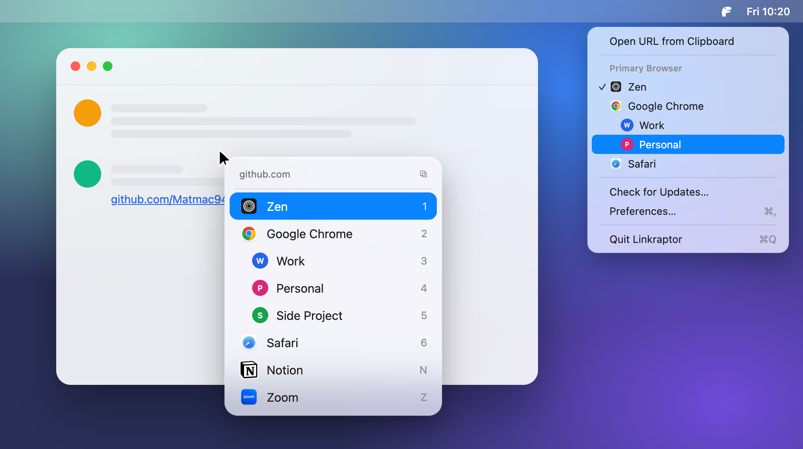

# Linkraptor

Linkraptor catches every link you click and asks which browser (or Chrome profile) should open it. It's a small, native macOS app that lives in your menu bar.



## It's just a fork

Linkraptor is a personal fork of [Browserino](https://github.com/AlexStrNik/Browserino) by Aleksandr Strizhnev, which was itself inspired by [Browserosaurus](https://github.com/will-stone/browserosaurus). All the credit for the app goes to them.

This fork fixes a few bugs I ran into with Browserino and adds features I wanted for myself. Everything after the fork was vibe-coded, so expect rough edges. Like Browserino, it's licensed under the GPL-3.0.

What it changes:

- Builds with the macOS 26 SDK.
- A picker redesigned for macOS 26: a Liquid Glass panel that sizes itself to the list, with bigger rows and number keys 1–9 to open them.
- A menu bar menu (the Rex dinosaur): open the link on your clipboard, or choose your primary browser.
- Chrome profiles: choose which profiles appear in the picker, give each a name, and open links straight into one.
- Private-browsing arguments are edited in a pop-up.
- A one-line installer and automatic updates.

# Install

Needs macOS 26. Paste this into Terminal:

```bash
curl -fsSL https://raw.githubusercontent.com/Matmac945/Browserino/main/scripts/install.sh | bash
```

Then set Linkraptor as your default browser: **System Settings → Desktop & Dock → Default web browser**.

That's it. Linkraptor checks for updates once a day and installs them on its own. To check right away, open the dinosaur menu in the menu bar and choose **Check for Updates…**.

<details>
<summary>Prefer to install from the DMG?</summary>

1. Download [Linkraptor.dmg](https://github.com/Matmac945/Browserino/releases/latest/download/Linkraptor.dmg) and drag Linkraptor into Applications.
2. Open it. macOS will say it can't verify the developer, because Linkraptor isn't signed with a paid Apple certificate. Click **Done**.
3. Go to **System Settings → Privacy & Security**, scroll down, and click **Open Anyway** next to Linkraptor.

You only need to do this once. Updates install without asking.
</details>

# Releasing a new version (maintainers)

You'll need Xcode, the [GitHub CLI](https://cli.github.com) and the update-signing key in your Keychain. Commit your changes, then run:

```bash
scripts/release.sh 1.2.0
```

The script builds a universal app, packages `Linkraptor.dmg`, signs the update and publishes a GitHub Release. Everyone's copy picks it up within a day.

The update-signing key lives in the macOS Keychain under the account `linkraptor`. Without it you can't ship updates, so back it up:

```bash
build/SourcePackages/artifacts/sparkle/Sparkle/bin/generate_keys --account linkraptor -x linkraptor-private-key.txt
```

Store that file somewhere safe, like a password manager, and never commit it.

# Build from source

```bash
git clone https://github.com/Matmac945/Browserino.git
cd Browserino
xcodebuild -project Browserino.xcodeproj -scheme Browserino -configuration Release -derivedDataPath build build
codesign --force --deep --sign - build/Build/Products/Release/Linkraptor.app
ditto build/Build/Products/Release/Linkraptor.app /Applications/Linkraptor.app
```

# The original Browserino

To get the original app instead:

```bash
brew tap AlexStrNik/Browserino
brew install browserino --no-quarantine
```

If you want to support the original author, you can buy Browserino on [Gumroad](https://alexstrnik.gumroad.com/l/browserino).
